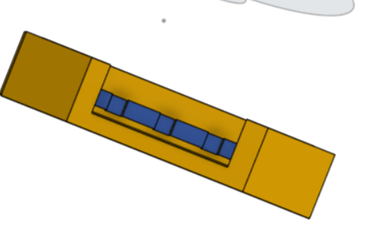
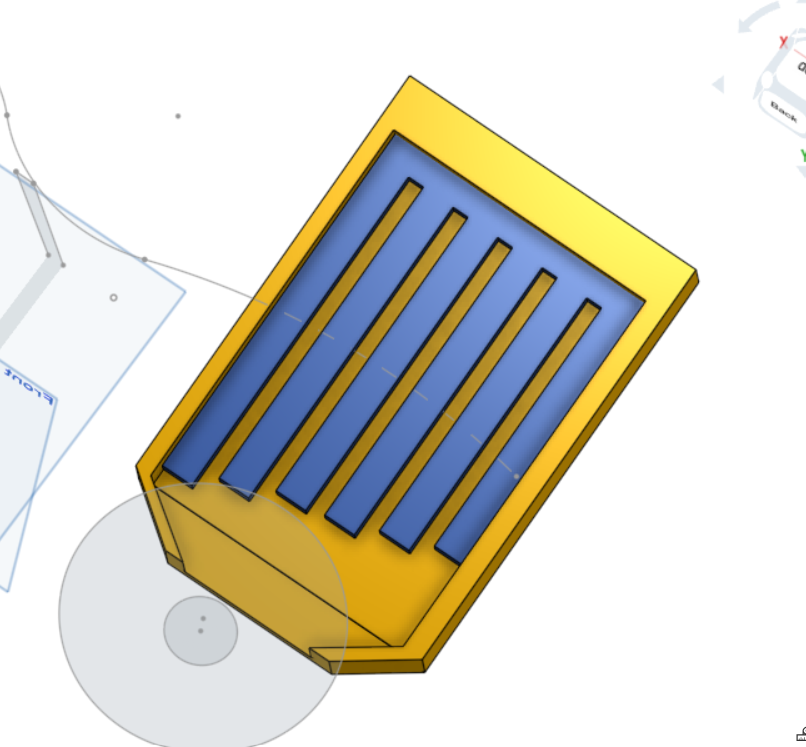
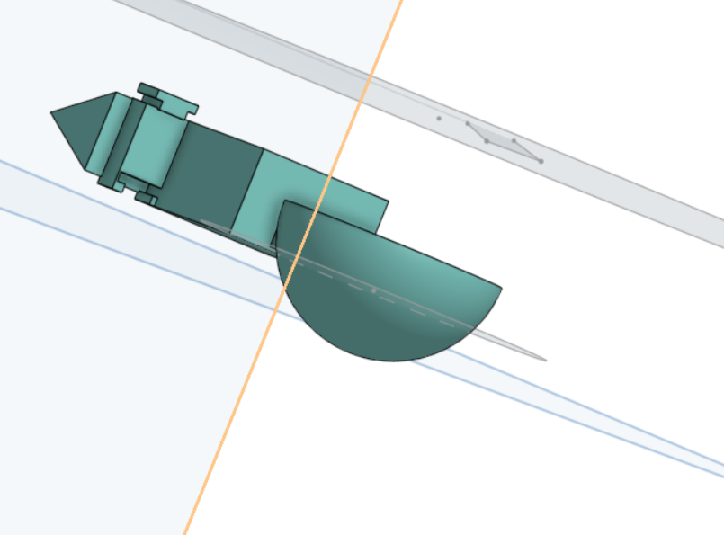
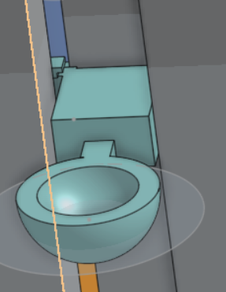
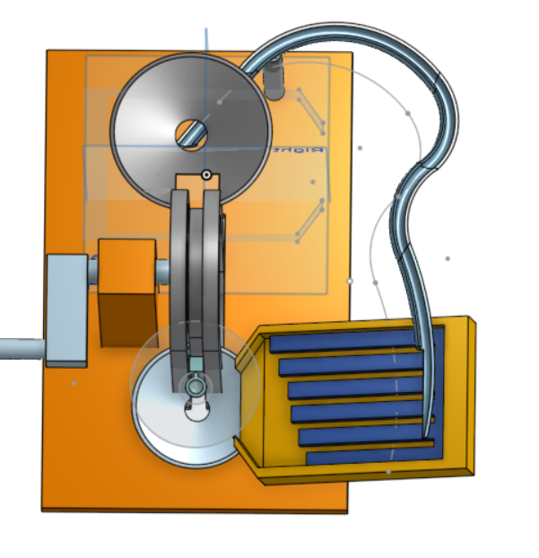
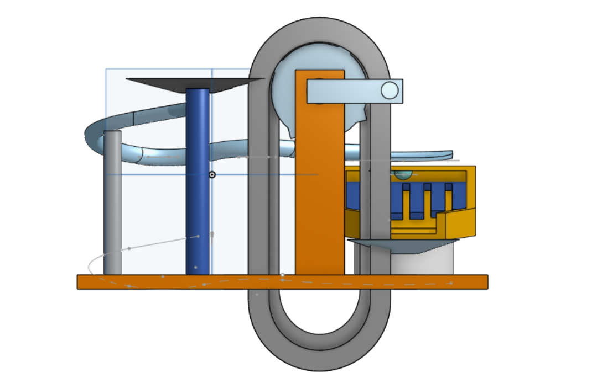
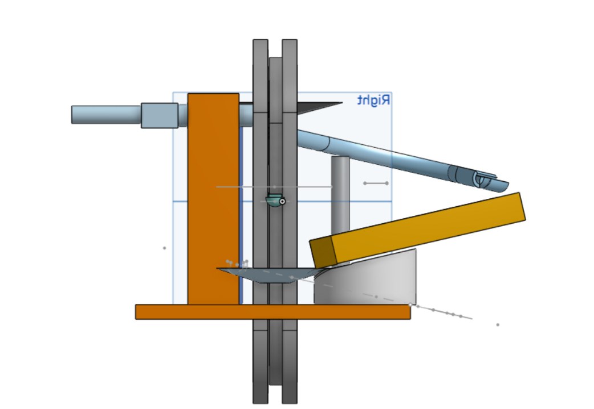

# MERBLlone
HELLO person reviewing this project, bc ur probably the only one who is going to read this thing HAHA. Let me present you MERBLPHONE, i took inspiration from the starter project but decided to add a little melody to it. *wink wink*

SO my project has an automatic marble dispenser, youll se in the project the whole chain is not featured, bur rather only one piece, as it is always the same piece and can be simply assembled, i thought it was redundant to feature EVERY single one - the whole system can be actioned with the lever and it has a 2mm tolerance to prevent it from sticking and not turning at all. Moreover youll see that at the end of the track there is a little music box at the end, that is the part that makes the sound. The blue part is meant to be made with the same dimensions but out of aluminum to produce some notes of the 4th octave when marbles hit it. The fourth octave was the one i chose bc it was the one that made not  only the most sense dimensions wise but also produced a low enough sound for it to sound like music and not random metal noises.

Overall the project taught me a lot about CAD especially as I had never used onshape before, however i do feel that some functions are quite limited compared to other softwares i had used previously and that slowed me down a little bit. Nonetheless i think it is a very comprehensive program fit for beginners that want to design stuff a bit more complex than simple figures that other beginner programmes feature. BTW, the function to make the tracks is quite tricky.

Anyway here are some photos of the project and the dismensions for I used for the aluminum part and which note they make >:D.

There is a 5mm gap to prevent the chasis of dampening the vibrations of the alu part, THAT IS CRUCIAL.

Here is the chain component, when building u should print around 76 to fit around and youll see there is a simple one way connector, OFC the part where it locks is bigger than the portruding part. 

Finally here are some overviews of the whole thing

The measurements of the alu sheet

| Note | Frequenz (Hz) | Länge für 5 mm Aluminium (cm) |
| :--- | :-----------: | :---------------------------: |
| **C4** | 261.6 | **10.5 cm** |
| **D4** | 293.7 | **9.9 cm** |
| **E4** | 329.6 | **9.3 cm** |
| **F4** | 349.2 | **9.1 cm** |
| **G4** | 392.0 | **8.6 cm** |
| **A4** | 440.0 | **8.1 cm** |
| **B4** | 493.9 | **7.6 cm** |
| **C5** | 523.3 | **7.4 cm** |

